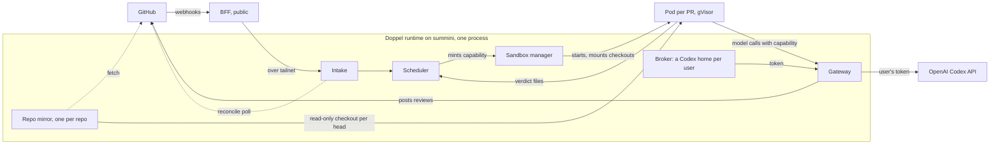

# Doppel as a Service: runtime spec

Status: design, nothing built or run yet. As of 2026-11-19.
Handoff copy: [Doppel as a Service](https://claude.ai/artifact/JaZBwBpA2jTUhEwNUxTV8X). This file is the source of truth; the doc is only how it was passed over.

Doppel as a service turns Doppelwerk, which reviews Summation's PRs from one Mac mini on one person's subscriptions, into a multi-tenant service. Most of the parts already exist. Doppelwerk does the review. steven-universe already holds a subscription sign-in in OpenBao and lets gVisor sandboxes use it through a gateway, without the token entering the sandbox.

This repo is the **doppel runtime**: the one place where work happens and secrets live. The UI and the BFF are Troy's.

## 1. Decisions

1. **The POC is Codex only.** Claude waits for Anthropic's answer (see [section 12](#12-vendor-terms)).
2. **Each user's Codex sign-in lives in its own Codex home, held by the runtime's broker.** It outlives every pod. OpenBao keeps a durable copy.
3. **Pods are user-agnostic.** They run the Codex SDK with the gateway as model provider. The scheduler picks whose sign-in pays for each reviewer by minting that run's capability.
4. **One pod per PR.** It holds every reviewer for that PR, across every head. It is deleted when the PR merges or closes, or after 3 days with no review. An `@doppelwerk` mention brings it back on the current head.
5. **The runtime tracks each PR's current head and every review it posted.** A pod keeps nothing that has to outlive it.
6. **Static review only.** Nothing from the PR is installed, built or run.
7. **One process with five roles:** intake, scheduler, broker, gateway, sandbox manager.
8. **It runs on summini**, as its own macOS user, in a Linux VM with Docker and gVisor. For Friday it finds PRs by polling.
9. **Records** (tenants, users, apps, rules) belong to the BFF. **Secrets, sandboxes and GitHub writes** belong to the runtime.

## 2. What belongs where

The test for any piece: if it holds a secret, touches a sandbox, or writes to GitHub, it belongs to the runtime. If it is a person's intent or record, it belongs to the BFF.

| Runtime | BFF (not this repo) |
| --- | --- |
| Intake: GitHub events in, deduped by delivery id, plus a reconcile poll | Tenants, users, apps and rules as records (Postgres is their source of truth) |
| Scheduling: which reviewers run on which head, on whose credential | The UI, console sign-in, invites |
| The ledger: PRs, slots, verdicts, findings, posts, dispositions, keyed by tenant | Billing and plans |
| The broker: each user's provider sign-in, refresh, status | Editing doppels and rubrics (the UI writes them; the runtime reads them) |
| The sandbox manager: create, mount, limit, stop, reap | The GitHub App install callback (public; owns the tenant↔installation link) |
| The gateway: model egress for pods, and the only GitHub writer | Credential status only (`connected / expired / revoked` and when), never the secret |
| Usage and capacity: per-user windows, caps, waits | Dashboards beyond a job's status (reads the runtime's API) |

"Apps" are the GitHub repos a tenant chose to have doppel review. Rules are app-wide or personal.

## 3. Architecture



The scheduler decides whose sign-in pays for each reviewer. The pod only ever holds capabilities; the gateway swaps in that user's token on the way to OpenAI.

**Listeners.** The pod network reaches only the gateway's model route. The gateway's GitHub-posting route, the broker and the runtime's own API listen on an interface pods can't reach. (Doppelwerk's notes list "any container can reach the broker" as a gap; steven-universe runs broker and gateway as two listeners on one process.)

**Webhooks.** Summini is on Tailscale only. Options, in order of preference:

1. The BFF receives webhooks (it is already public) and forwards them over the tailnet. Keep a reconcile poll, because webhooks get lost.
2. A tunnel on summini: Tailscale Funnel or Cloudflare Tunnel.
3. Poll only, as Doppelwerk does. Enough for Friday.

## 4. A PR's lifecycle

| PR state | Pod | What triggers the next state |
| --- | --- | --- |
| `open`, first review due | Created when its first slot is ready | A slot becomes ready |
| `open`, reviewing | Up; reviewers join and leave as slots start and finish | New head, CI done, a command, a review request |
| `idle` | Up with no Codex process running | 3 days with no review → pod deleted |
| `idle`, pod deleted | None | `@doppelwerk` mention or a new review request → pod recreated on the current head |
| `merged` / `closed` | Running reviewers stopped; pod and checkouts deleted | — |

The ledger rows stay after the pod is gone, for dedupe across rounds and for learning.

### GitHub events

| Event | What the runtime does |
| --- | --- |
| `installation`, `installation_repositories` | The BFF records which repos the tenant can pick; the runtime refreshes its list |
| `pull_request` opened / reopened / ready_for_review | Queue the app's reviewers at the head |
| `pull_request` synchronize | Stop reviewers still running on the old head; queue the new head in the same pod. (Doppelwerk lets the run finish and throws the verdict away.) |
| `pull_request` review_requested | Queue that person's doppel (Doppelwerk's main trigger) |
| `pull_request` closed | Stop its reviewers, delete the pod and its checkouts, keep the ledger rows |
| `issue_comment` with `@doppelwerk` | A command, with a guaranteed visible reply (Doppelwerk's `commands.py`). Brings back a pod that idled out. |
| `pull_request_review_thread` resolved; replies to review comments | A person's disposition: drop the finding next round |
| `check_suite` / `check_run` completed | Release slots waiting on CI. Doppelwerk waits up to 30 min for code doppels. |
| `push` to the default branch | Refresh the rules and guides read from the base |

## 5. The scheduler: one matching system

The scheduler keeps Doppelwerk's shape (find work, queue it in a ledger, run it) but turns claiming into matching. Every reviewer on a head is a **slot**. Each tick (every few seconds, or on an event) it starts every slot whose conditions all hold, in the PR's one pod. There is no fixed order of steps.

### Doppelwerk today (what we start from)

One loop in `daemon.py` runs every 60 s (`src/doppelwerk/` on `origin/main`):

- **Poller** (`poller.py`). Four passes of `gh` searches per repo:
  - review requested: `user-review-requested:<login>` per rostered person, giving that person's doppel;
  - auto-route: repo-owner doppels on every PR; specialists (security, infra) where paths or labels match; in the monorepo, personal doppels `doppels/OWNERS` picks, each scoped to the files that person owns;
  - `@doppelwerk` commands, in their own table with a guaranteed visible reply;
  - path triggers (off).
- **Checks before queuing:** this head not already reviewed by that doppel and not running; the doppel serves the repo, trust ≥ 1, branch not on the skip list; for repo owners, CI finished (waits up to 30 min without marking the head seen).
- **Ledger as queue** (`ledger.py`, SQLite `jobs`): one row per (repo, PR, head, doppel, command), unique index; `not_before`; 3 attempts; at most 3 re-queues for a fast-moving PR; running jobs go back to queued at boot.
- **Pool** (`pool.py`): `drain()` claims every due job oldest first, no priority or fairness; 10 workers on summini with a per-engine cap; head checked before and after each review, verdict dropped and re-queued after a 90 s settle window if it moved (27 of 239 reviews in one day were wasted); broker busy → wait 45 s, no attempt counted; out of usage → RC's other accounts, then the other engine.

### Slot conditions

A queued slot starts when all of these hold:

| Condition | Rule |
| --- | --- |
| Settled | A push sets the PR's slots' `not_before` 90 s out; each further push resets it. Doppelwerk's settle rule, applied from the first push. |
| CI | Reviewers that can approve wait for CI on their head, up to 30 min. Personal reviewers don't wait. |
| Payer cap | The payer has fewer than 2 running slots. |
| Usage window | The payer isn't waiting out a usage-limit reset. |
| Host cap | Summini is under its cap on running reviewers (about 10). |
| Payer has a sign-in | Otherwise the slot is `blocked`; the BFF shows "connect Codex" and the PR says so once. |

When a slot starts: the PR gets a pod if it has none, the scheduler mints a capability (PR, slot, reviewer, payer, expiry, token budget) and stores only its hash, and the harness starts that reviewer's Codex process.

When a head moves: slots still running on the old head are stopped inside the pod; queued slots on the old head are dropped and re-queued on the new head. The pod stays.

### Who pays

| Reviewer | Runs on | Why |
| --- | --- | --- |
| A personal doppel (e.g. Steven's rubric) | Its owner's own credential | The user doing their own review work: the strongest case for "individual use" |
| An app-wide reviewer (the repo's rules; Doppelwerk's `repo_owner` doppels) | The tenant's API key; failing that, a named owner who opts in | Belongs to no one person, so one member's subscription for everyone's PRs is the weakest case |

No fallback onto another user's credential. Doppelwerk switches accounts when one runs out; in a multi-user service that is account sharing. When the gateway sees a usage-limit answer, it records the user's reset time, the scheduler sets `not_before` on that user's queued slots, and the PR says "out of capacity until <reset>". The only fallback is another engine the same user has connected.

### Ledger schema (SQLite, WAL)

```sql
prs   (id, tenant, repo, pr,
       current_head,
       pod_id,            -- null while the PR has no pod
       last_review_at,    -- drives the 3-day idle cleanup
       state)             -- open | idle | merged | closed
UNIQUE (tenant, repo, pr)

slots (id, pr_id, head_sha, reviewer, payer_user,
       reason,            -- review_requested | app | command
       command_id,        -- '' when not a command: SQLite treats NULLs as distinct
       state,             -- queued | blocked | running | posted | failed | skipped | cancelled
       waiting_on,        -- settle | ci | payer_cap | usage_window, while queued
       not_before,        -- end of the settle window, the CI deadline or the usage reset
       attempts, capability_hash, verdict,
       review_id)         -- the GitHub review it posted
UNIQUE (pr_id, head_sha, reviewer, command_id)
```

Plus Doppelwerk's commands, findings, posts and dispositions tables, keyed by tenant and PR. WAL mode is fine on the Linux VM's own disk; Doppelwerk's WAL trouble came from summini's virtiofs mount.

### Finishing a slot

1. Validate the verdict file against `verdict.schema.json`.
2. Scan it for credential-shaped strings.
3. Run Doppelwerk's `criticality.decide` to choose APPROVE or COMMENT.
4. Post through the gateway, record the `review_id` on the slot and the PR.
5. The pod stays for the PR's next head.

On restart, running slots go back to queued. Each open PR's pod is kept if it is still up, or recreated for its next slot.

### Port, write, leave out

| Port almost as-is | Write new | Leave out until there's evidence |
| --- | --- | --- |
| The ledger's dedupe index and `not_before` | Slots matched to one pod per PR | Priority |
| The poller's searches and checks | Choosing the payer | Fairness between tenants (the per-user cap keeps one person from taking every slot) |
| The head-moved guard | Per-user caps and usage-limit waits | A separate queue service |
| The command table with its guaranteed reply | Minting capabilities | |
| `criticality.decide` | Stopping one reviewer inside a running pod; the pod's idle cleanup | |

## 6. The PR sandbox

One generic image, built per engine release. Nothing about a PR, repo, user or rule is baked in. Doppelwerk's `Dockerfile` is the starting point (`python:3.12-bookworm`, git, gh, Node 22, unpinned CLIs).

| In the image | Mounted per PR, never in the image |
| --- | --- |
| Debian slim, non-root, read-only root filesystem | Each head's checkout under `/work/<head>`, read-only |
| git, ripgrep, jq, ca-certificates | `/job`: PR metadata, GitHub's diff, CI annotations, each doppel's `SKILL.md`, `scopes.yaml` and `watchouts/`, the app's rules |
| A pinned Codex SDK and its `codex` binary, using the gateway as model provider, no sign-in of its own | One capability per reviewer run, never a token |
| A small harness: read `/job`, run one Codex process per reviewer run, validate each against `verdict.schema.json`, write `/out/<reviewer>.json`, stop a reviewer on request | A scratch folder per run, wiped when the run ends |

Never in the pod: repo toolchains, `node_modules`, anything from the PR that would run, `gh` or any GitHub token. The pod never talks to GitHub.

The SDK runs in the pod; the sign-in stays outside it. steven-universe's working setup (`python/libs/agent-runtime/core/agent.py`):

```python
"model_providers.gateway.base_url": f"{gateway_url}/model",
"model_providers.gateway.env_key": "AGENT_CAPABILITY",
"model_providers.gateway.wire_api": "responses",
"model_providers.gateway.requires_openai_auth": False,
```

One Codex process serves one provider, so it carries one capability ([spike 0a](../spikes/codex-sdk.md)). The harness starts a Codex process for each reviewer run, with that run's capability in its environment, and closes it when the run ends. An idle pod runs no Codex process.

### Getting the PR in

- The runtime keeps one bare mirror per repo, cloned with `--filter=blob:none`, as Doppelwerk does. It fetches with the tenant's installation token, on the runtime, never in the pod.
- For each new head it fetches `refs/pull/<n>/head` and writes a checkout of that exact head into its own folder. `git archive <head> | tar -x` keeps `.git` out of the pod; Doppelwerk uses `git worktree add --detach`.
- The PR's pod mounts one read-only parent folder with a folder per head. A new head shows up without remounting, and one checkout serves every reviewer on that head. A head's folder is deleted once no slot uses it.
- Rules, guides and repo context are read from the **base** ref, never the head, so a PR can't rewrite the rules that judge it.
- The head's own `AGENTS.md` must not load as instructions. Codex reads `AGENTS.md` from its working directory; `project_doc_max_bytes = 0` keeps it out, and a repo-level `.codex/config.toml` doesn't load ([spike 0c](../spikes/codex-sdk.md)).
- Reviewers see the whole repo, not just the diff, so they can open callers, read tests and grep. Doppelwerk already works this way.
- The review is static. Doppelwerk gives Claude `--allowedTools Read,Grep,Glob` and Codex `--sandbox read-only`. Its only window into execution is CI's results, read through the API. Running the PR is Crew's verifier's job.

### Why one pod per PR

| | Pod per PR run | **Long-lived pod per PR (chosen)** |
| --- | --- | --- |
| Lives | One head's review: minutes | Until merge or close, or 3 days idle |
| New push | Kill the run; start a new pod | Add the new head's checkout; stop reviewers on the old head |
| CI wait | Reviewers that wait for CI need a second pod | Reviewers join the same pod when their CI is done |
| What a PR leaves behind | Nothing | Stays for that PR's next run, kept small by a read-only root and a per-run scratch folder |
| Idle cost | None | A pod per open PR; an idle pod runs no Codex process |
| Cancel | Delete the pod | Interrupt one reviewer's turn and close its Codex process |
| On EKS later | A Job per run | A pod per open PR, with the mirror as a cache volume |

## 7. Credentials

### Codex subscription (the POC)

steven-universe's broker, made per user:

1. The user starts the connection in the UI.
2. The runtime runs Codex's device-code sign-in in a Codex home that is theirs (`codex login --device-auth`, or the SDK's `login_chatgpt_device_code`).
3. The user enters the code on OpenAI's page. No code passes through us.
4. The resulting `auth.json` lives in OpenBao under `kv/users/<user>/codex`, readable only by the broker's role.
5. The broker refreshes it under a lock per user. Refresh tokens rotate, so two refreshers break the sign-in. The broker drives refresh: no model call runs in the broker's Codex home, so Codex never refreshes there "on use".
6. Each pod gets a capability per reviewer plus the gateway URL.
7. The gateway maps capability → user → that user's token and swaps it in.

Device-code sign-in has to be switched on in the user's ChatGPT security settings, and a workspace admin can block it.

What the sign-in is: OAuth 2.0, no key pairs. Browser sign-in with PKCE redirecting to `localhost:1455`, or device code on a headless machine. `auth.json` holds:

- `id_token`: a JWT naming the account and plan, valid an hour;
- `access_token`: the bearer token model calls use, valid about 10 days;
- `refresh_token`: good for about 30 days;
- `account_id` and `last_refresh`.

A model call sends `Authorization: Bearer <access_token>` with a `chatgpt-account-id` header to `chatgpt.com/backend-api/codex`. Refresh trades the refresh token for a new pair and the old refresh token stops working. API-key mode holds a static key with nothing to refresh.

The broker refreshes once `last_refresh` is 6 h old, and the gateway refreshes once and retries on an upstream 401, as steven-universe does ([spike 0d](../spikes/codex-sdk.md)).

### API keys (either provider)

The user or tenant pastes a key into the UI. It goes straight to the runtime's OpenBao; the BFF passes it through and never stores it. It is shown back only as its last four characters. The gateway injects it. This is the clean path for customers, and for app-wide reviewers that aren't any one person's.

### GitHub App

The one key pair in the system. Its private key signs a short JWT, which buys hour-long installation tokens. The runtime caches each installation's token and reuses it until shortly before it expires.

### Claude subscription (later, not in the POC)

The user signs in to the unmodified `claude` CLI itself, in a box with their own config volume (`CLAUDE_CONFIG_DIR`). Only that user's runs mount the volume. We never read, copy or proxy the token, so a Claude reviewer can't share the user-agnostic pod: it gets its own pod. `claude setup-token`, where the user pastes a year-long token into our UI, would mean we collect the token; it isn't the path.

## 8. Where it runs: summini

Summini is an M4 Pro, 14 cores, 48 GB, macOS 26.6.2. Doppelwerk runs there as user `rc` under Apple's `container` through [Davit](https://github.com/wouterdebie/davit): `doppeld` gets 8 CPUs and 16 GB, `doppelboard` serves on :8080, the engine broker runs on the host. Docker isn't installed.

Plan: Docker in a Linux VM, plus gVisor (`runsc`). It reuses steven-universe's `sandbox-runner` nearly as-is (warm pool, single-use pods, 26 ms claim) and moves off the Mac unchanged.

| | Docker in a Linux VM (chosen) | Apple `container` (Doppelwerk) |
| --- | --- | --- |
| Isolation | Shared VM kernel; gVisor on top | Each container its own lightweight VM |
| Networks | A per-pod `--internal` network plus an egress sidecar | Isolated networks exist on macOS 26, but every container shares one bridge today |
| Portability | Same API on any Linux host | macOS only |

- Run as its own macOS user, not `rc`. Leave Doppelwerk alone: it is Summation's production reviewer, and the `rc` session also runs personal apps.
- Capacity: `doppeld` already takes 16 GB. At about 2 GB per running reviewer pod, the VM holds 10 to 12 concurrent reviews. Each user's subscription window runs out long before the machine does.
- OpenBao in steven-universe is unsealed by hand (2 of 3 Shamir shares after every restart). On summini a reboot stops all reviews until someone unseals it. Decide whether that's acceptable for Friday, or use auto-unseal.

## 9. Rules

Each rule needs a test or a run that proves it, with its ID in the test name.

- **DSV-1:** Tenants, users, apps and rules are the BFF's records. The runtime reads them through the BFF's API, or receives them pushed. It keeps only its own state: PRs, slots, verdicts, findings, posts, and credentials with their status. It reports credential status changes back to the BFF.
- **DSV-2:** A repo is reviewed only once its organization has installed the doppelwerk GitHub App on it and a tenant owner has chosen it in the UI. Every GitHub call uses that installation's token, minted by the runtime and reused until shortly before it expires (an hour at most), never another tenant's.
- **DSV-3:** A user connects a subscription only through the provider's own sign-in flow. We never ask for a password or a pasted subscription token, and never show one back. An API key may be pasted; it goes to OpenBao and is shown back only as its last four characters.
- **DSV-4:** A user's credential runs only reviewers that user owns, or app-wide reviewers they opted in to. It is never a fallback for anyone else's.
- **DSV-5:** Each PR has one pod, which holds every reviewer for that PR. It is deleted when the PR merges or closes, or after 3 days with no review; an `@doppelwerk` mention brings it back on the current head. Each head's code is checked out at run time from the runtime's mirror and mounted read-only. The image holds nothing per PR, repo, user or rule.
- **DSV-6:** The pod holds no GitHub credential and can't reach GitHub. Its only output is one verdict file per reviewer in `/out/`. The runtime validates each against the verdict schema and posts it.
- **DSV-7:** The review is static. Nothing from the PR is installed, built or run, and the engines get read-only tools.
- **DSV-8:** The pod's network reaches only the gateway's model route; every other destination is refused. The gateway's GitHub-posting route and the broker listen where pods can't reach them. Each reviewer's model calls carry a capability the scheduler minted for that run. It names one user, expires with the run, and has a token budget.
- **DSV-9:** Rules, guides and repo context come from the PR's base ref, never its head. The head's own agent instruction files are not loaded as instructions.
- **DSV-10:** A new head stops that PR's reviewers still running on the old head and schedules the new head in the same pod. A merged or closed PR stops its reviewers and deletes its pod and checkouts. A head's checkout is deleted once no slot uses it.
- **DSV-11:** Verdicts and posting keep Doppelwerk's contract: P0 to P3 findings; one grouped review per reviewer per head; approval only by an app-wide reviewer, with CI green and no P0 or P1; personal reviewers only comment; stale approvals are dismissed on a new head.
- **DSV-12:** Each user has a concurrency cap, starting at 2. When a provider reports a usage-window limit, that user's slots wait until the reset, and the PR says so.
- **DSV-13:** Tenants and users stay apart: the ledger is keyed by tenant; each user has their own OpenBao path and policy; every capability in a pod names a user of that pod's tenant; a verdict is scanned for credential-shaped strings before it is posted.
- **DSV-14:** The runtime holds each PR's current head and every review it posted. A pod keeps nothing that has to outlive it, so deleting one loses no history.

## 10. Risks

- **Reviewers in one pod can see each other's capabilities.** A prompt injection in the PR could get one reviewer to spend another user's capability on the same PR. It can't get a token and can't reach anything but the gateway's model route; the capability's expiry and token budget (DSV-8) bound the damage. If it ever matters, the fix is one pod per reviewer, nothing else changing.
- **Files carry over within a PR.** A long-lived pod keeps what a reviewer writes between runs, so a reviewer misled by the PR could leave notes for its next run. The root filesystem is read-only and each run's scratch folder is wiped; nothing crosses to another PR.
- **Rate limits are per user, and reviews come in bursts.** A busy repo can drain one person's 5-hour window in an afternoon. Doppelwerk's capacity regexes and steven-universe's `rate_limit_reached_type` reading detect it; neither prevents it.
- **Refresh tokens rotate.** A second refresher, or the user signing in to Codex on their laptop with the same account, can invalidate the stored sign-in. steven-universe hasn't confirmed that a scheduled refresh lands in OpenBao (`tracker.md`), and detecting a revoked sign-in isn't built: its model route answers a failed refresh with a 500.
- **Enforcement without notice.** Anthropic says it may enforce its credential rules without notice. A service that depends on subscriptions can stop overnight; API keys are the hedge.

## 11. Delivery

### Build order

1. Repo skeleton: one runtime process with its five roles, and a ledger keyed by tenant.
2. The broker per user: device-code sign-in, refresh under a per-user lock, a durable copy in OpenBao at `kv/users/<user>/codex`.
3. The gateway: capability → user → token, model calls passed through with usage counted, posting route on a separate listener.
4. The sandbox image and harness, plus the pod per PR with a read-only checkout per head from the mirror.
5. Intake by polling, the matching scheduler, and posting through a new doppelwerk-dev GitHub App with Doppelwerk's verdict schema and criticality rules.
6. The BFF contract with Troy: records in, credential status out.
7. Stopping reviewers on a new head, the pod's idle cleanup, and waiting out a user's usage window.

### Friday: the smallest demo

- Tenant Summation, two users (Steven and Troy), one sandbox repo. Not agent-cloud, so production Doppelwerk is untouched.
- A new doppelwerk-dev GitHub App, installed on that repo only.
- The runtime on summini, as its own user, in a Linux VM with Docker and gVisor, finding PRs by polling.
- Each user connects Codex by device code; their sign-in lives in their own Codex home, held by the broker.
- A PR gets one personal reviewer per user and one app-wide reviewer, as Codex processes in the PR's one pod, each on its own payer's sign-in through the gateway.
- Reviews post as doppelwerk-dev[bot].
- A push stops reviewers on the old head and starts the new head in the same pod; merging deletes the pod.
- The UI shows each user's connection status and the app's run history.
- Show the subscription path on Summation staff only, labelled an internal experiment. Show API keys as the path a customer would use.

None of this is proven yet. Each step needs a run seen working before it's claimed.

### Guardrails

- Never touch Doppelwerk on summini (user `rc`).
- Ask Steven before installing anything on summini.
- Never print, log or commit a token, `auth.json` or a private key.
- No Claude in the POC.
- Claim a step done only after a run shows it working.

### Out of scope

- Running the PR's code: Crew's verifier, in agent-cloud's `pr-review.md`.
- Fixing PRs: mode B in `pr-review.md`.
- Billing.
- Hosting anywhere but summini.
- Learning personas automatically. Doppelwerk builds them by hand from a person's review history, and so does this.

### Later, on evidence

- Warm sandbox pools (steven-universe claims a warm pod in 26 ms).
- A container per user's Codex home, if the broker process itself becomes the threat.
- Auto-unseal for OpenBao.
- Webhook-only intake, once a month of reconcile polls has found nothing missed.
- Moving Summation's own Doppelwerk reviews onto the service, after a shadow period. This is the end goal.

**Overlap with agent-cloud.** `docs/specs/pr-review.md` (PR #6191) puts the same review in Crew (agent-runtime-v2 on Fly, Sprites as sandboxes). That's fine for an experiment. Keep the GitHub-facing contract identical (the verdict, the posting rules, the repo's review guide) so the host can move later without users seeing a change, and pick one long-term home before either is built past the demo.

## 12. Vendor terms

**Anthropic forbids the gateway model for Claude.** Its [Claude Code legal page](https://code.claude.com/docs/en/legal-and-compliance):

> Anthropic does not permit third-party developers to offer Claude.ai login into their own applications, or to route requests through Free, Pro, Max, or Ultra plan credentials on behalf of their users. Moreover, developers may not collect, store, or intermediate Claude.ai credentials or session tokens — sign-in to a Claude account must complete through Anthropic's own flow.

The one allowed path: a platform that has accepted the Commercial Terms hosts the unmodified `claude` binary, each user signs in with their own subscription, and the platform doesn't pay for or resell the usage. Usage limits "assume ordinary, individual usage", and Anthropic may enforce without notice.

**OpenAI is grayer.** [Codex's auth docs](https://learn.chatgpt.com/docs/auth) recommend API keys for automation, allow a copied `auth.json` or device-code sign-in on a private machine, and call ChatGPT access tokens "intended for trusted scripts, schedulers, and private CI runners". OpenAI's terms forbid sharing account credentials. [Sign in with ChatGPT](https://workos.com/blog/sign-in-with-chatgpt-plan-usage-scope) (secondary source) lets third-party apps spend a user's plan (scope `chatgpt.tokens.use.direct`, per-app weekly caps); hosted products apply through an interest form. steven-universe's own spec (MA5) reached the same line: its broker is for Steven's personal use, and serving anyone else means "an API key (route D) or each user's own login (route C)".

| | Claude | Codex |
| --- | --- | --- |
| Bring your own API key | Allowed; the gateway may hold and inject it | Allowed, and recommended by OpenAI for automation |
| Bring your own subscription | Only by the user signing in to the unmodified `claude` CLI in our sandbox. No gateway, no token in our store. Ask Anthropic before any tenant outside Summation. | Device-code sign-in, held by our broker, swapped in by the gateway. Apply to OpenAI's program before any tenant outside Summation. |

### Ask the vendors

OpenAI, through the Sign in with ChatGPT interest form, before any tenant outside Summation (send these first):

- May a hosted service run Codex on a user's own ChatGPT plan through device-code sign-in, keeping the token server-side and swapping it in through a gateway?
- Or must it use the `chatgpt.tokens.use.direct` program?
- What are that program's terms for a background, non-interactive agent?

Anthropic, through [contact sales](https://www.anthropic.com/contact-sales), before Claude joins:

- May a platform that has accepted the Commercial Terms keep a user's signed-in, unmodified Claude Code config, to run that user's reviews while they're away?
- Is a personal reviewer commenting on PRs the user was asked to review "ordinary, individual usage"? Is an app-wide reviewer on one member's plan?
- Does a Team or Enterprise seat change the answer?

## 13. Open questions

1. ~~**Refresh timing.**~~ Answered: the access token lasts 10 days; refresh at 6 h and on a 401 ([spike 0d](../spikes/codex-sdk.md)).
2. ~~**Stopping one reviewer.**~~ Answered: `interrupt()` ends one turn at once while others finish ([spike 0b](../spikes/codex-sdk.md)).
3. ~~**Several capabilities in one Codex process.**~~ Answered: no; one Codex process per reviewer run ([spike 0a](../spikes/codex-sdk.md)).
4. **Idle pod cost.** An idle pod runs no Codex process by design (spike 0a). Still to measure: one Codex process's memory, and an idle pod's, in checkpoint 5.
5. **The head's `AGENTS.md`.** Kept out by `project_doc_max_bytes = 0` ([spike 0c](../spikes/codex-sdk.md)). Still open: how the base's rules and guides are fed in (DSV-9), likely as the reviewer's instructions from `/job`.
6. **App-wide reviewers.** The tenant's API key, or an owner's opted-in subscription? For Friday there is no API key path yet, so whose sign-in pays?
7. **The Linux VM on summini.** Colima, Lima, OrbStack or Docker Desktop, and does gVisor run in it on Apple silicon?
8. **The GitHub App.** A new public App, or the existing App 4213368 (Summation only, with `contents: write`, more than a reviewer needs)?
9. **Branch protection.** Does an App's APPROVE count toward required reviews? Secondary sources say yes when the repo's settings allow it. Test on the demo repo.
10. **Rules format.** Keep Doppelwerk's files (`doppel.yaml`, `SKILL.md`, `scopes.yaml`, `watchouts/`) as data the UI edits, or a simpler schema? The first keeps every existing persona working.
11. **Personal rubrics.** Does the UI help a new user build theirs from review history, or start them on a default?
12. **Long-term home.** Summini and this runtime, or Crew as `pr-review.md` plans?
13. **Doppelwerk's future.** Does the service replace it for Summation, and when?
14. **OpenBao unseal.** By hand after each reboot, or auto-unseal?
15. **Checkout time.** Measure a head's checkout of summationai/code from its mirror (expected about a second for a normal repo).

## Sources

- Anthropic, [Claude Code legal and compliance](https://code.claude.com/docs/en/legal-and-compliance): authentication and credential use; hosting Claude Code in products.
- OpenAI, [Codex authentication](https://learn.chatgpt.com/docs/auth): API keys for automation, device-code sign-in, `auth.json`, access tokens.
- WorkOS, [Sign in with ChatGPT plan usage](https://workos.com/blog/sign-in-with-chatgpt-plan-usage-scope) (secondary): the scope, per-app caps, the interest form.
- [Davit](https://github.com/wouterdebie/davit): the Apple `container` GUI that runs Doppelwerk on summini.
- Doppelwerk, `summationai/doppelwerk` `origin/main` at 36aff3f (the local clone sits on an old branch): `AGENTS.md`, `Dockerfile`, `ops/mini/engine-broker.py`, `ops/mini/doppelwerk-boot.sh`, `doppelwerk/runner.py`, `poller.py`, `pool.py`, `poster.py`, `criticality.py`, `schema/verdict.schema.json`, `claude.rc/*.md`.
- steven-universe: `docs/specs/agent-service/model-access.md` (MA1 to MA6), `control-plane.md`, `sandbox-runner.md`, `python/services/agent-service/app/{broker,gateway}/`, `python/services/sandbox-runner/`, `python/libs/agent-runtime/core/agent.py`, `infra/secrets-manager/`.
- agent-cloud, `docs/specs/pr-review.md` (PR #6191): the overlapping agc-review plan in Crew.
- Summini, read live on 2026-11-19: macOS 26.6.2, M4 Pro, 14 cores, 48 GB; `doppeld`, `doppelboard` and `engine-broker.py` running as `rc`; no Docker.
